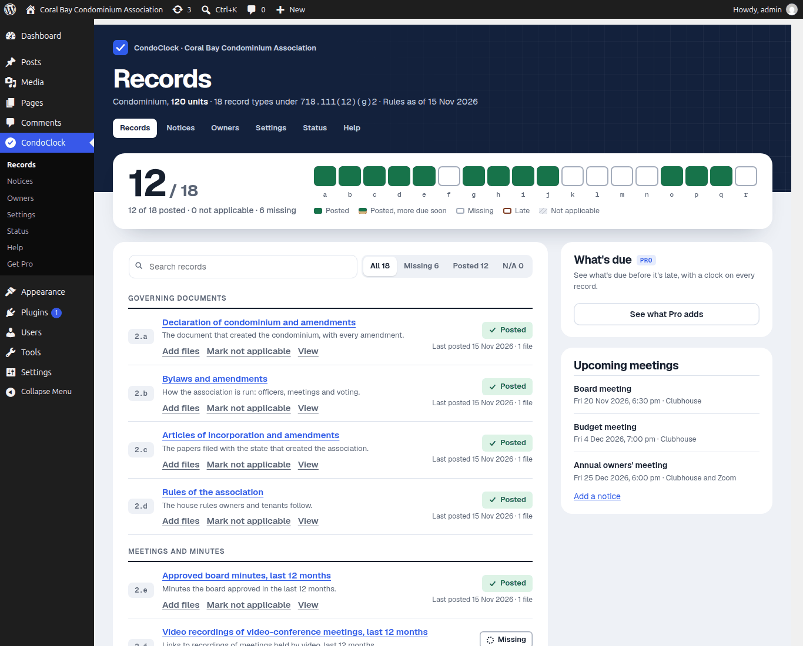
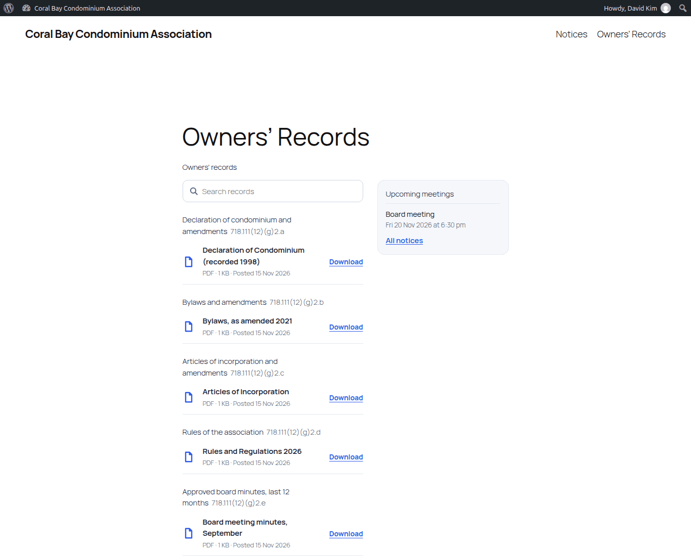
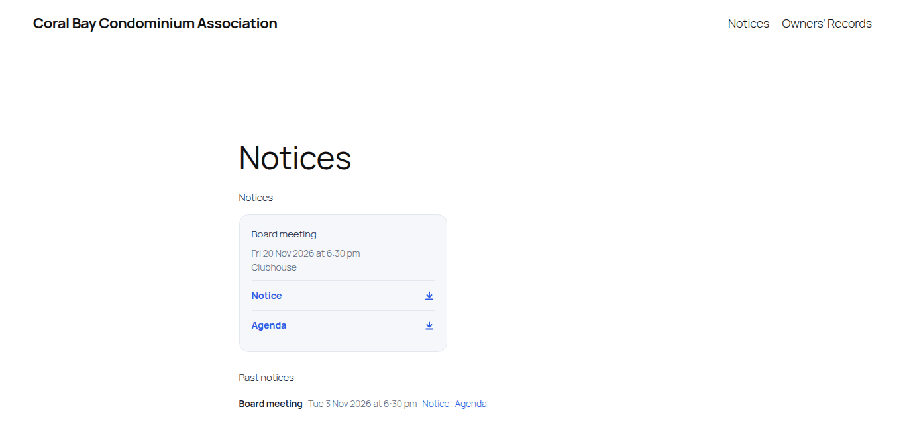
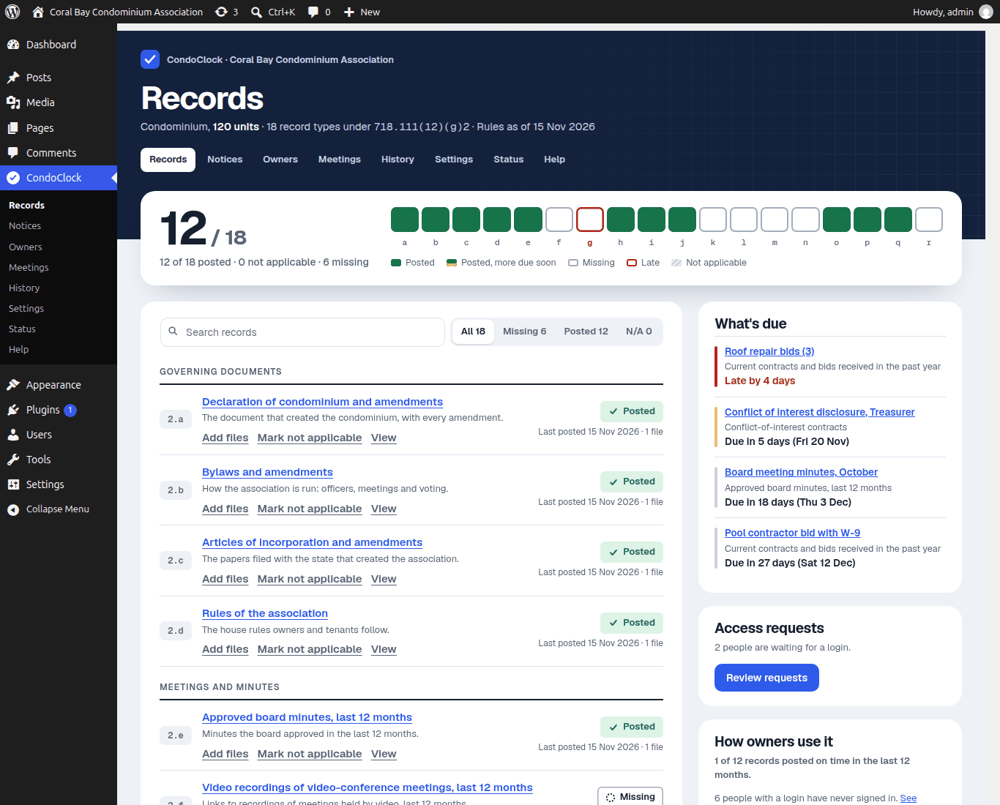

# CondoClock – Condo & HOA Records and Meeting Notices

**What it is:** a free WordPress plugin that gives your association an owners-only records page and a public meeting notices page.

**Who it's for:** Florida condo associations with 25 or more units, HOAs with 100 or more parcels, and the managers and web designers who run their sites.

**How to use it:** 1. download the zip below and upload it in WordPress; 2. pick condo or HOA and your number of units; 3. drag your documents onto their row and add your owners.

## What your association gains

- **Fewer calls and record requests:** owners log in and read the documents themselves, each with the date it went up.
- **Know what's still missing:** every record the statute lists, as a checklist, with the section of Chapter 718 or 720 next to it.
- **Meetings owners actually see:** a Notices page for upcoming meetings, linked from your front page.
- **Private files stay private:** only logged-in owners and staff can open them, and CondoClock tests your server itself and tells you the exact fix if it shows them anyway.
- **Every owner can read it:** owners' pages in English, Spanish and Haitian Creole.

Free, with no trial and nothing locked. It makes no requests to outside servers: your records stay on your site.

## See it

*The Records board: what's posted and what's missing, at a glance.*

*The Owners' Records page that logged-in owners see.*

*The Notices page with upcoming meetings.*

*CondoClock Pro: what's due, with a clock on every record.*

## Download and install

1. Download **[condoclock.zip](https://github.com/Facilo-es/condoclock/releases/latest/download/condoclock.zip)** (latest version).
2. In WordPress, go to **Plugins → Add New → Upload Plugin**, choose the zip and activate it.
3. Open **CondoClock**, pick condominium or HOA, enter your number of units or parcels, and drag the documents you already have onto their row.

## CondoClock Pro: every deadline on time

- A clock on every record and every meeting, so the board sees what's due before it's late.
- Email reminders before each deadline.
- Owners request a login, and you approve it in one click. Import your owner list in one go.
- A dated history you can export.
- A warning when a file holds emails, phone numbers or other private details, before it goes up.

**USD 149 a year for one association, or USD 449 a year for up to 10 associations, for web designers and managers.** [Get CondoClock Pro](https://checkout.freemius.com/plugin/45028/plan/79404/) · 14-day money-back guarantee.

## Questions

**How do owners get a login in the free version?**
You add them in **CondoClock → Owners** with their name, email and unit. CondoClock creates a WordPress user with the Owner role and emails them a link to set their own password. You can resend that email or remove access at any time. With Pro, owners can also request a login themselves, and you approve it.

**Where are the files stored, and are they backed up?**
In your own WordPress site: in a private folder inside `wp-content/uploads/condoclock-private/`, with a random name, served only to logged-in owners and staff. The record list lives in your WordPress database. CondoClock doesn't make backups itself, so use your host's or your usual WordPress backup and make sure it includes the uploads folder.

**Is it only for Florida?**
Yes, it's built for Florida. The records checklist and the meeting rules follow Chapter 718 (condos) and Chapter 720 (HOAs). The owners-only records page and the Notices page would work anywhere, but the checklist would show Florida's list, not your state's.

**I see a trial mentioned on the checkout page. Is there one?**
No. CondoClock Pro has no trial: the free plugin is the way to try it. Any trial wording you see on the checkout is generic text from Freemius, the payment service, and doesn't apply here. You have 14 days to get your money back.

**Does Pro keep working if I don't renew?**
Yes. Everything you have keeps working. You just stop getting updates and support.

**How do updates arrive?**
For now, as new releases here on GitHub: download the new zip and upload it over the old one. Once CondoClock is listed on wordpress.org, updates will arrive in your WordPress dashboard like any other plugin. Pro updates come through your licence in WordPress.

**Who makes it?**
Facilo, a small studio in Spain. Write to support@facilo.es.

## Important

CondoClock isn't legal advice. Your association's attorney decides what your documents and deadlines are.

Support: support@facilo.es · [facilo.es](https://facilo.es) · Licence GPLv2 or later.
